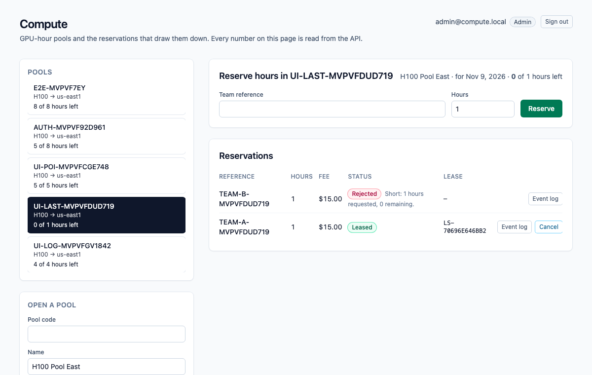
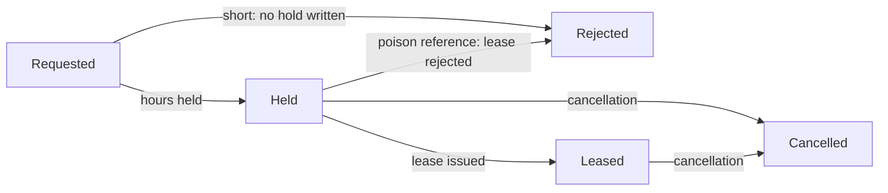
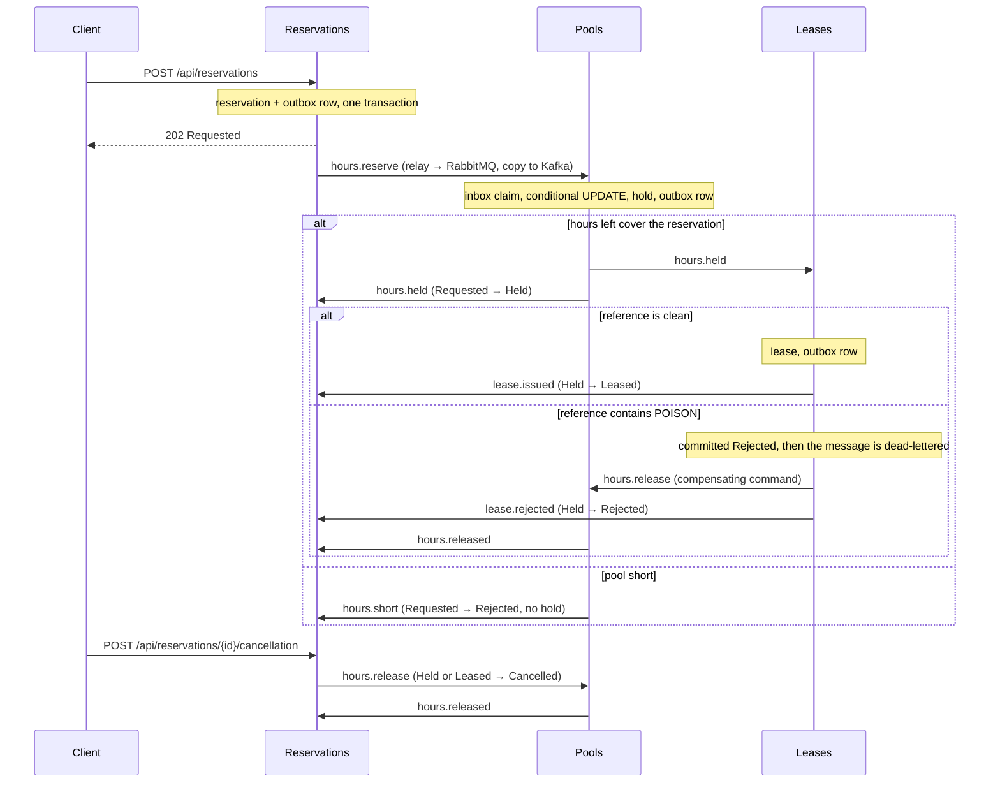
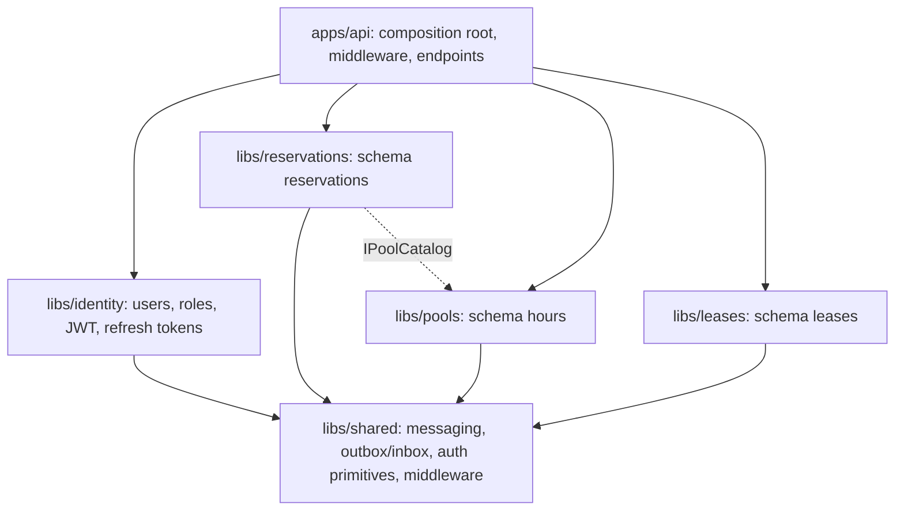

# dotnet-compute

GPU-hour pools and the reservations that draw them down. The scarce number is the **hours left** in a pool (for example 64 H100-hours on one day), and the **Pools** module is its only writer: it holds hours with a single conditional `UPDATE` that matches only while the hours left still cover the reservation, so when two teams fight for the last hours, one commits a hold and the other is told the pool is short and no hold is written. A team reference that contains the poison token `POISON` is committed as rejected by the Leases module, the message is dead-lettered, and a compensating command gives the hours back. A later cancellation also gives the hours back, but it does not roll back the lease that was already issued.

One ASP.NET Core process, one Postgres database. An HTTP write saves the reservation and an outbox row in one local transaction; a `BackgroundService` relay publishes outbox rows to RabbitMQ (the work queue) and Kafka (the event log); the next module consumes from RabbitMQ, claims an inbox key in the same transaction as its own write, and writes its own row and outbox row. Saga steps never call each other in-process. Delivery is at-least-once: the relay can publish and crash before it marks a row sent, so the row goes out again, and every consumer dedupes with its inbox key. Each saga step only moves a reservation forward from the status it expects.

Everything behind the saga is signed in: **ASP.NET Core Identity** with **JWT access tokens and rotating refresh tokens** (see [Authentication and authorization](#authentication-and-authorization)). Customers see and cancel only their own reservations; staff see everything and open pools.

> The demo credentials in `compose.yaml` and `appsettings.Development.json` are for local use only. Set `JWT_KEY` and `ADMIN_PASSWORD` (see `.env.example`) before putting this anywhere shared. Compose binds every port to `127.0.0.1`.



*The UI reads everything from the API; shown signed in as the seeded administrator, on the pool where two reservations fought for the last hours: one reservation was leased, the other was told it is short.*

## Reservation statuses



`Cancelled` and `Rejected` (after a hold) give the hours back through a `ReleaseHours` command, and Pools releases a hold at most once. The lease has its own status (`Issued` or `Rejected`) and a cancellation never changes it. If the cancellation gets there before the final mark, the late mark finds the reservation is no longer `Held` and does nothing.

## How the modules talk



| Module | Owns | Consumes | Emits |
| --- | --- | --- | --- |
| **Identity** (`libs/identity`) | `identity` schema: users, roles, refresh tokens. | | |
| **Reservations** (`libs/reservations`) | `Reservations`: status, hours, fee, team reference. Validation, the poison rule, the fee. | `hours.held`, `hours.short`, `lease.issued`, `lease.rejected`, `hours.released` | `hours.reserve`, `hours.release` (cancellation) |
| **Pools** (`libs/pools`) | `Pools.HoursLeft` (sole writer after the pool opens) and `HourHolds`. | `hours.reserve`, `hours.release` (prefetch 1) | `hours.held`, `hours.short`, `hours.released` |
| **Leases** (`libs/leases`) | `Leases`. | `hours.held` | `lease.issued`, `lease.rejected`, `hours.release` (poison) |
| **Shared** (`libs/shared`) | The relay, the consumer loop with retry and dead-letter, the Kafka log, auth primitives, middleware. Each module owns its own `OutboxMessages` and `InboxMessages` tables. | | |

RabbitMQ topology is declared in code (`libs/shared/Messaging/Topology.cs`): exchange `compute.work`, one queue per module (`pools.commands`, `leases.work`, `reservations.events`), a `.retry` queue per module (2 s TTL, then back to the main queue, 3 attempts), and a `.dlq` per module behind `compute.dlx`. A transient failure retries; a poison message goes straight to the dead-letter queue after its rejection is committed. Kafka has one topic, `compute.events`, one partition, replication factor 1, keyed by reservation id.

## Architecture

One deployable (`apps/api`), several libraries. Each business module is its own class library with its own `DbContext`, its own Postgres **schema** (`identity`, `reservations`, `hours`, `leases`), its own migrations and its own outbox and inbox tables. No module references another; the only shared code is `Compute.Shared`, and the one cross-module read (a pool's existence and pricing inputs) goes through an interface, `IPoolCatalog`, that Pools implements and Reservations consumes.



Modules still talk only through messages: RabbitMQ carries the commands, Kafka keeps the event log, and the outbox and inbox make delivery at-least-once and consumption idempotent.

## Authentication and authorization

| Piece | How it works |
| --- | --- |
| Accounts | ASP.NET Core Identity. Passwords need 10+ characters with upper case, lower case and a digit, and 4 distinct characters. Five wrong passwords lock the account for 15 minutes (`429`). A wrong password and an unknown email give the same `401`. |
| Access token | JWT (HS256), 15 minutes, held **in memory** by the Angular app and sent as `Authorization: Bearer`. The signing key must be at least 32 bytes; the API refuses to start without one. |
| Refresh token | 256 random bits in an `HttpOnly`, `SameSite=Strict`, `Path=/api/auth` cookie (`Secure` over HTTPS). Only its SHA-256 is stored. Every refresh **rotates** it with a conditional `UPDATE`, so two concurrent refreshes with the same token cannot both win. Presenting a token that was already used revokes the whole family. Refresh and logout also need an `X-Requested-With: compute-web` header, so another site cannot trigger them. |
| Roles | `Customer` (default at registration), `Staff`, `Admin`. An administrator is seeded from configuration on first start. |
| Rules | Anonymous: `/api/health`, `/api/auth/*`. Any signed-in user: read pools, book, read and cancel **their own** reservations and leases. `Staff` and `Admin`: open pools, read everything, read the event log. Another user's reservation or lease is `404`, not `403`, so ids do not leak. The owner in a reservation is the caller; a body field cannot set it. |
| Hardening | Rate limit on `/api/auth/*` per client (`RateLimit:AuthPerMinute`), security headers on every response (`nosniff`, `DENY`, strict CSP, `no-referrer`), a correlation id echoed in `X-Correlation-Id` and in every problem response, JSON logs (`Logging:Json`), forwarded headers only when `ForwardedHeaders:Enabled`, a fallback policy that makes every endpoint authenticated unless it opts out, and a readiness endpoint that checks every module schema. |

## Run it

Needs Node 22 (npm 10), .NET SDK 10.0.401 (`global.json`), Docker (arm64 is fine) and python3 for the smoke script.

```bash
npm ci
dotnet test tests/Compute.UnitTests   # 110 tests, no Docker
docker compose up -d --wait db        # the integration tests use Postgres on 5475 (database compute_test)
docker compose exec db createdb -U compute compute_test   # once
dotnet test tests/Compute.IntegrationTests
docker compose up --build --wait      # db, kafka, rabbitmq, api, web
./scripts/smoke.sh                    # last line: compute smoke passed
npx playwright install chromium       # once
npx playwright test                   # the browser specs against http://127.0.0.1:8095
docker compose down                   # keeps the Postgres volume; `down -v` drops it
```

| Service | Host port |
| --- | --- |
| Web (nginx, proxies `/api/`) | 8095 |
| API (`/scalar/v1`, `/api/health`) | 5215 |
| Postgres 17 | 5475 |
| Kafka 3.8.1 (KRaft, one broker) | 9125 |
| RabbitMQ 3.13 / management UI (`platform` / `platform`) | 5705 / 15705 |

Inside the Compose network the API and nginx listen on 8080 and Kafka's internal listener is 9092.

## Try it with curl

The web app is at <http://127.0.0.1:8095> (`admin@compute.local` / `ComputeAdmin2026` in the demo stack, or register a customer). From the shell:

```bash
API=http://127.0.0.1:5215
login() { curl -s -X POST $API/api/auth/login -H 'content-type: application/json' -d "{\"email\":\"$1\",\"password\":\"$2\"}" | python3 -c 'import sys,json; print(json.load(sys.stdin)["accessToken"])'; }
ADMIN="Authorization: Bearer $(login admin@compute.local ComputeAdmin2026)"

curl -s -X POST $API/api/pools -H "$ADMIN" -H 'content-type: application/json' \
  -d '{"code":"SANTOS-RTM-1","name":"H100 Pool East","gpuModel":"H100","region":"us-east1","hourCapacity":10}'

curl -s -X POST $API/api/auth/register -H 'content-type: application/json' \
  -d '{"email":"ana@example.com","password":"Passw0rd-Demo1"}'      # 201; its accessToken goes in $ANA below
ANA="Authorization: Bearer <accessToken>"

curl -s -X POST $API/api/reservations -H "$ANA" -H 'content-type: application/json' \
  -d '{"poolCode":"SANTOS-RTM-1","reference":"TEAM-1001","hours":3}'
# 202, status Requested. Use the returned id:

curl -s -H "$ANA" $API/api/reservations/<id>             # Leased after a few seconds, with a lease number
curl -s -H "$ANA" $API/api/leases/<id>
curl -s -H "$ANA" $API/api/pools/SANTOS-RTM-1     # hoursLeft 20
curl -s -H "$ADMIN" $API/api/reservations/<id>/events    # the Kafka log; staff only (a customer gets 403)

curl -s -X POST -H "$ANA" $API/api/reservations/<id>/cancellation   # hours come back; the lease stays
```

A reservation is validated at the door: reference required (at most 40 characters), hours from 1 to 24 hours. The poison match is a case-sensitive substring: `TEAM-POISON-7` and any longer token containing `POISON` match.

## Develop with Nx

The repository is an Nx workspace (`nx.json`, plugin `@nx/dotnet`). `npx nx show projects` lists `api`, `web`, the four libraries and both test projects.

```bash
docker compose up -d --wait db kafka rabbitmq   # the brokers and Postgres, not the app
npx nx serve api                                # http://localhost:5215 (Development: seeded admin, public docs)
npx nx serve web                                # http://localhost:4290, proxies /api to the API
WEB_URL=http://localhost:4295 npx playwright test   # the same browser specs, against the dev servers
npx nx run-many -t typecheck lint -p web        # tsc --noEmit and ESLint (angular-eslint)
npx nx build web && npx nx build api            # what CI builds
```

## What is tested, and where it runs

- **Unit tests** (`tests/Compute.UnitTests`, 110 tests, no Docker, about 3 seconds): the reservation rules and fee, the poison rule including integer overflow, token creation and validation, password and lockout behaviour of the auth service on an in-memory store, owner-or-staff access, the retry policy and topology, message serialization, the outbox `DbContext` conventions, and the HTTP middleware (problem details are `application/problem+json`, security headers, correlation ids).
- **Integration tests** (`tests/Compute.IntegrationTests`, 48 tests, real Postgres): the hours race (two tasks, two `DbContext`s, one unit: one `Held`, one `Short`, no hold for the loser) and the check constraint behind it; the saga handlers against the real schema (duplicate delivery claimed once, a release returns the hours once, the poison rejection committed before the dead-letter, cancellation then late final mark); and the **whole HTTP pipeline** through `WebApplicationFactory`: register, login, wrong password, lockout, expired and tampered tokens, refresh rotation, replay revoking the family, two concurrent refreshes (exactly one wins), logout, the same-gpuModel header, the auth rate limit, and 401/403/404 for every route and ownership case. The race test was run against a read-then-write version of the hold, where it failed, and against the conditional update, where it passes.
- **`scripts/smoke.sh`** drives the composed stack: authentication and ownership first (401, 403, 404), then validation, the happy path (fee, lease, Kafka log), the last hours with three concurrent reservations, the poison reference (rejected, `leases.work.dlq` gains one message, hours restored), and a cancellation that lands between the lease and the final mark. To make that last window wide enough to hit on purpose, Compose sets `Reservations__FinalMarkDelayMs=1500`; it is a latency knob and defaults to 0.
- **Playwright** (`e2e/specs`, 11 tests, Chromium): `auth.spec.ts` (anonymous sees only the form, wrong password, password policy, a customer books and sees only their own reservations with no staff controls, sign-out, the session surviving a reload through the cookie while `document.cookie` stays empty); `reserve.spec.ts` (open a pool, book, lease, reload, cancel); `ui-flows.spec.ts` (refusal messages, the poison rejection, the loser in a race, the Kafka event log). They run against the composed web port and against the Nx dev servers.
- **CI** (`.github/workflows/ci.yml`) has two jobs. `verify`: `npm ci`, Prettier check, `dotnet format whitespace --verify-no-changes`, unit tests, integration tests (Postgres 17 service) with coverage uploaded, a NuGet vulnerability check, `npm audit`, `nx typecheck` and `nx lint` for web (zero warnings allowed) and `nx build`. `e2e`: builds the Compose stack, runs the smoke and every Playwright spec, and uploads traces and prints logs on failure. Dependabot watches NuGet, npm, Actions and Docker.

## Cloud mapping

This repository runs on Compose. Nothing in it calls a cloud account. There is no Pub/Sub client in the process.

| Here | On Google Cloud |
| --- | --- |
| Postgres 17 | Cloud SQL for PostgreSQL |
| Kafka 3.8 | A Pub/Sub topic or managed Kafka |
| RabbitMQ 3.13 | A Pub/Sub subscription with a dead-letter topic |
| The API and the web app | Cloud Run |

## API

JSON over HTTP. Everything except health and `/api/auth/register|login|refresh|logout` needs a bearer token. Interactive docs are at `http://127.0.0.1:5215/scalar/v1` (OpenAPI at `/openapi/v1.json`) when `Docs:Public` is true, which Compose and Development set; otherwise they need a staff token.

| Method and path | What it does | Responses |
| --- | --- | --- |
| `GET /api/health`, `GET /api/health/ready` | Liveness; readiness (every module schema reachable). | `200`, `503` |
| `POST /api/auth/register` | Creates a customer and signs them in. | `201`, `400` policy, `409` email taken, `429` |
| `POST /api/auth/login` | Signs in; sets the refresh cookie. | `200`, `401`, `429` locked or rate limited |
| `POST /api/auth/refresh`, `POST /api/auth/logout` | Rotate or revoke the refresh cookie. Need `X-Requested-With: compute-web`. | `200`/`204`, `400` header missing, `401` |
| `GET /api/auth/me` | The caller. | `200`, `401` |
| `POST /api/pools` | Opens a pool with its hour capacity. Staff. | `201`, `400` invalid, `403`, `409` code exists |
| `GET /api/pools`, `GET /api/pools/{code}` | Pools with the live hours left. | `200`, `404` |
| `POST /api/reservations` | Accepts a reservation (1 to 24 hours) for the caller and starts the saga. | `202` Requested, `400` invalid, `404` unknown pool, `409` duplicate reference |
| `GET /api/reservations?poolCode=` | The caller's latest 100 reservations (staff: everyone's), optionally for one pool. | `200` |
| `GET /api/reservations/{id}` | One reservation and its status. Owner or staff. | `200`, `404` |
| `POST /api/reservations/{id}/cancellation` | Moves a held or leased reservation to `Cancelled` and gives the hours back. The lease is not touched. Owner or staff. | `202`, `404`, `409` wrong status |
| `GET /api/reservations/{id}/events` | The Kafka event log for one reservation. Staff. | `200`, `403` |
| `GET /api/leases/{reservationId}` | The lease row. Owner or staff. | `200`, `404` |

Errors come back as `application/problem+json` with a `title` and the `correlationId`.

## Configuration

Compose sets these on the API container. Defaults in `apps/api/appsettings.json` point at the published host ports, so `nx serve api` works against `docker compose up -d --wait db kafka rabbitmq`.

| Setting | Compose value | Meaning |
| --- | --- | --- |
| `ConnectionStrings__Compute` | `Host=db;Port=5432;Database=compute;Username=compute;Password=compute` | The one Postgres database. Migrations run on startup. |
| `RabbitMq__Host` / `__Port` / `__User` / `__Password` | `rabbitmq` / `5672` / `platform` / `platform` | Work queue. Virtual host `/`. |
| `Kafka__BootstrapServers` | `kafka:9092` | Event log. |
| `Jwt__Key` | `${JWT_KEY}` or a demo key | HS256 signing key, at least 32 bytes. Required; startup fails without it. |
| `Jwt__AccessMinutes` / `__RefreshDays` / `__SecureCookies` | `15` / `14` / `false` | Token lifetimes; set `SecureCookies` when TLS ends in front of the API. |
| `Identity__SeedAdmin__Email` / `__Password` | `${ADMIN_EMAIL}` / `${ADMIN_PASSWORD}` | Administrator created on first start. |
| `RateLimit__AuthPerMinute` | `120` (code default `20`) | Requests a minute per client to `/api/auth/*`. |
| `ForwardedHeaders__Enabled` | `true` | Trust `X-Forwarded-*` from the reverse proxy (nginx here). Leave off when the API is reached directly. |
| `Docs__Public` | `true` | Serve Scalar and OpenAPI without a token. |
| `Logging__Json` | `true` | Structured JSON console logs. |
| `Reservations__FinalMarkDelayMs` | `1500` | Milliseconds the final mark waits. A latency knob so the smoke can land a cancellation inside the window. `0` outside Compose. |
| `COMPUTE_TEST_DB` (tests only) | | Postgres connection for `dotnet test`. Defaults to `localhost:5475`, database `compute_test`. CI points it at its service container. |

## Look inside and fix things

```bash
docker compose ps                      # five services, all healthy
docker compose logs -f api             # relay, consumers, poison and retry lines
docker compose exec db psql -U compute -d compute -c 'select "RoutingKey","SentAt" from "OutboxMessages" order by "Id" desc limit 10'
open http://127.0.0.1:15705        # RabbitMQ management, platform / platform
```

- **Dead-lettered messages** sit in `leases.work.dlq`. Nothing replays them; inspect them in the management UI. Retries wait in `<queue>.retry` for 2 seconds.
- **A port is already in use**: `lsof -nP -i :5215` shows who holds it. Compose publishes only on `127.0.0.1`.
- **`dotnet test` cannot connect**: start Postgres first with `docker compose up -d --wait db`.
- **The smoke cannot reach the API**: run `docker compose up --build --wait` first; override the target with `API=... RABBIT=... ./scripts/smoke.sh`.
- **Start clean**: `docker compose down -v` drops Postgres, Kafka and RabbitMQ data. Plain `down` keeps them, and the smoke is safe on kept data because every code carries a run id.
- **The Kafka log looks empty right after a reservation**: the relay publishes within a second or so; reload the event log.

## Known limits

- Sign-in is email and password only: no email verification, password reset, MFA or external identity providers. Access tokens cannot be revoked before they expire (15 minutes); logout revokes the refresh token.
- Tokens are HS256 with one shared key, which is right for one API. A fleet that must verify tokens elsewhere should move to asymmetric keys.
- The auth rate limiter is in memory per process, so it does not coordinate across API instances.
- Delivery is at-least-once, not exactly-once. The inbox makes repeats harmless for the saga; the Kafka log can hold a duplicate event after a relay crash.
- One broker, one partition, replication factor 1, one API instance. The relay does not coordinate across instances (the inbox would absorb the duplicates, but the outbox is never trimmed).
- `GET .../events` scans the whole topic for each call. Fine here, not something to expose at scale.
- Lists are capped at 100 rows and not paginated.
- Dead-lettered messages are not replayed automatically.
- The browser specs drive Chromium at a desktop size only, and the `e2e` CI job needs Docker and takes a few minutes.

## Layout

```
apps/api       thin host: composition root, middleware, endpoints
apps/web       Angular 21, styled with Tailwind 4 utilities only (sign-in, role-aware workspace)
libs/shared    messaging (outbox, inbox, relay, consumers), auth primitives, middleware
libs/identity  users, roles, JWT, refresh tokens          (schema identity)
libs/reservations  reservation rules and the saga's first step    (schema reservations)
libs/pools  the only writer of the hours left     (schema hours)
libs/leases leases                            (schema leases)
tests/         Compute.UnitTests, Compute.IntegrationTests
e2e/           Playwright
scripts/       smoke.sh
compose.yaml   Postgres, Kafka, RabbitMQ, API, web
```

Nx 23.2.1 orchestrates `nx build web` and `nx build api`; Each module's EF Core migrations are committed under its library and the API applies them on startup. Packages are pinned centrally in `Directory.Packages.props`, and warnings are errors (`Directory.Build.props`).

## Other systems in this .NET track

- [dotnet-freight](https://github.com/joshbarros/dotnet-freight): container space on ocean sailings.
- [dotnet-clinic](https://github.com/joshbarros/dotnet-clinic): appointment slots in a provider session.
- [dotnet-ledger](https://github.com/joshbarros/dotnet-ledger): outgoing payments from an account balance.
- [dotnet-warehouse](https://github.com/joshbarros/dotnet-warehouse): warehouse stock and outbound orders.
- [dotnet-academy](https://github.com/joshbarros/dotnet-academy): course cohort seats and enrollments.
- [dotnet-hotel](https://github.com/joshbarros/dotnet-hotel): hotel room-nights.
- [dotnet-tickets](https://github.com/joshbarros/dotnet-tickets): event ticket tiers and orders.
- [dotnet-carbon](https://github.com/joshbarros/dotnet-carbon): carbon credit batches and purchases.
- [dotnet-charging](https://github.com/joshbarros/dotnet-charging): EV charger slot reservations.
- [dotnet-promo](https://github.com/joshbarros/dotnet-promo): limited-use promo codes and redemptions.
