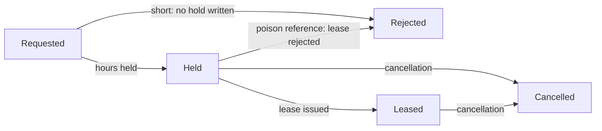
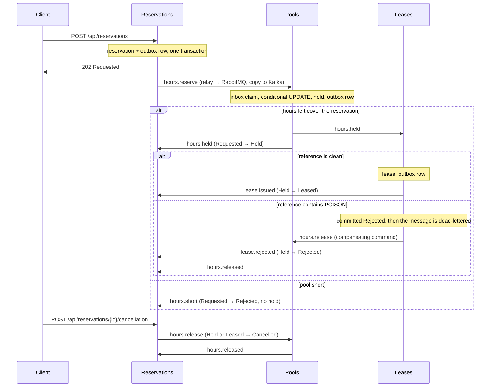

# dotnet-compute

GPU-hour pools and the reservations that draw them down. The scarce number is the **hours left** in a pool (for example 64 H100-hours on one day), and the **Pools** module is its only writer: it holds hours with a single conditional `UPDATE` that matches only while the hours left still cover the reservation, so when two teams fight for the last hours, one commits a hold and the other is told the pool is short and no hold is written. A team reference that contains the poison token `POISON` is committed as rejected by the Leases module, the message is dead-lettered, and a compensating command gives the hours back. A later cancellation also gives the hours back, but it does not roll back the lease that was already issued.

One ASP.NET Core process, one Postgres database. An HTTP write saves the reservation and an outbox row in one local transaction; a `BackgroundService` relay publishes outbox rows to RabbitMQ (the work queue) and Kafka (the event log); the next module consumes from RabbitMQ, claims an inbox key in the same transaction as its own write, and writes its own row and outbox row. Saga steps never call each other in-process. Delivery is at-least-once: the relay can publish and crash before it marks a row sent, so the row goes out again, and every consumer dedupes with its inbox key. Each saga step only moves a reservation forward from the status it expects.

> The Compose network is local and unauthenticated. There is no login, no token and no cookie. Do not publish these ports; Compose binds all of them to `127.0.0.1`.


*The UI reads everything from the API. Shown: a leased reservation, a cancellation that gave 6 hours back and kept its lease, a reservation rejected for the poison token, and one that was short.*

## Money

Fees are whole cents. A reservation is 1 to 24 GPU-hours at 320 cents per GPU-hour, with a minimum charge of 1,500 cents, so 4 hours costs the $15.00 minimum and 10 hours costs $32.00. Fee arithmetic is `checked`: it throws instead of wrapping.

## Reservation statuses



`Cancelled` and `Rejected` (after a hold) give the hours back through a `ReleaseHours` command, and Pools releases a hold at most once. The lease has its own status (`Issued` or `Rejected`) and a cancellation never changes it. If the cancellation gets there before the final mark, the late mark finds the reservation is no longer `Held` and does nothing.

## How the modules talk



| Module | Owns | Consumes | Emits |
| --- | --- | --- | --- |
| **Reservations** (`Modules/Reservations`) | `Reservations`: status, hours, fee, team reference. Validation, the poison rule, the fee. | `hours.held`, `hours.short`, `lease.issued`, `lease.rejected`, `hours.released` | `hours.reserve`, `hours.release` (cancellation) |
| **Pools** (`Modules/Pools`) | `Pools.HoursLeft` (sole writer after the pool opens) and `HourHolds`. | `hours.reserve`, `hours.release` (prefetch 1) | `hours.held`, `hours.short`, `hours.released` |
| **Leases** (`Modules/Leases`) | `Leases`. | `hours.held` | `lease.issued`, `lease.rejected`, `hours.release` (poison) |
| **Messaging** (`Messaging`) | `OutboxMessages`, `InboxMessages`, the relay, the consumer loop with retry and dead-letter, the Kafka log. | | |

RabbitMQ topology is declared in code (`Messaging/Topology.cs`): exchange `compute.work`, one queue per module (`pools.commands`, `leases.work`, `reservations.events`), a `.retry` queue per module (2 s TTL, then back to the main queue, 3 attempts), and a `.dlq` per module behind `compute.dlx`. A transient failure retries; a poison message goes straight to the dead-letter queue after its rejection is committed. Kafka has one topic, `compute.events`, one partition, replication factor 1, keyed by reservation id.

## Run it

Needs Node 22 (npm 10), .NET SDK 10.0.401 (`global.json`), Docker (arm64 is fine) and python3 for the smoke script.

```bash
npm ci
docker compose up -d --wait db        # dotnet test uses Postgres on 5475 (database compute_test)
dotnet test tests/api/Compute.Api.Tests.csproj
docker compose up --build --wait      # db, kafka, rabbitmq, api, web
./scripts/smoke.sh                    # last line: compute smoke passed
npx playwright install chromium       # once
npx playwright test                   # two specs against http://127.0.0.1:8095
docker compose down                   # keeps the Postgres volume; `down -v` drops it
```

| Service | Host port |
| --- | --- |
| Web (nginx, proxies `/api/`) | 8095 |
| API (`/scalar/v1`, `/api/health`) | 5215 |
| Postgres 17 | 5475 |
| Kafka 3.8.1 (KRaft, one broker) | 9125 |
| RabbitMQ 3.13 / management UI (`platform` / `platform`) | 5705 / 15705 |

Inside the Compose network the API and nginx listen on 8080 and Kafka's internal listener is 9092.

## Try it with curl

```bash
curl -s -X POST http://127.0.0.1:5215/api/pools \
  -H 'content-type: application/json' \
  -d '{"code":"H100-EAST-1112","name":"H100 Pool East","gpuModel":"H100","region":"us-east1","hourCapacity":30}'

curl -s -X POST http://127.0.0.1:5215/api/reservations \
  -H 'content-type: application/json' \
  -d '{"poolCode":"H100-EAST-1112","reference":"TEAM-1001","hours":10}'
# 202, status Requested, feeCents 3200. Use the returned id:

curl -s http://127.0.0.1:5215/api/reservations/<id>         # Leased after a few seconds, with a lease number
curl -s http://127.0.0.1:5215/api/leases/<id>
curl -s http://127.0.0.1:5215/api/pools/H100-EAST-1112      # hoursLeft 20
curl -s http://127.0.0.1:5215/api/reservations/<id>/events  # the Kafka log for this reservation

curl -s -X POST http://127.0.0.1:5215/api/reservations/<id>/cancellation \
  -H 'content-type: application/json'                       # hours come back; the lease stays
```

A reservation is validated at the door: team reference required (at most 40 characters), 1 to 24 hours. The poison match is a case-sensitive substring: `TEAM-POISON-7` and any longer token containing `POISON` match.

## Develop with Nx

The repository is an Nx workspace (`nx.json`, plugin `@nx/dotnet`). `npx nx show projects` lists `api` (the ASP.NET Core monolith), `web` (the Angular app) and the inferred xUnit project.

```bash
docker compose up -d --wait db kafka rabbitmq   # the brokers and Postgres, not the app
npx nx serve api                                # http://localhost:5215
npx nx serve web                                # http://localhost:4295, proxies /api to the API
WEB_URL=http://localhost:4295 npx playwright test   # the same browser specs, against the dev servers
npx nx run-many -t typecheck lint -p web        # tsc --noEmit and ESLint (angular-eslint)
npx nx build web && npx nx build api            # what CI builds
```

## What is tested, and where it runs

- **xUnit against real Postgres** (`tests/api`, 25 tests): two tasks with two `DbContext`s fight for one remaining hour (one `Held`, one `Short`, hours left 0, no hold for the loser); empty input, over-limit input, integer overflow (4294967297 must not wrap to 1), the fee and its minimum charge, the poison substring; the same message delivered twice is claimed once; a release returns the hours once; the poison rejection is committed before the dead-letter; a cancellation followed by the late final mark leaves the reservation `Cancelled` and the lease `Issued`. The race test was run against a read-then-write version of the hold, where it failed, and against the conditional update, where it passes.
- **`scripts/smoke.sh`** drives the composed stack with a run id on every code, so a kept volume does not collide: validation, the happy path (fee, lease, Kafka log), three concurrent reservations for one hour (one leased, two short, no hold for the losers), the poison reference (rejected, `leases.work.dlq` gains one message, hours restored), and a cancellation that lands between the lease and the final mark (reservation `Cancelled`, lease `Issued`, hours back, second cancellation `409`). To make that last window wide enough to hit on purpose, Compose sets `Reservations__FinalMarkDelayMs=1500`; it is a latency knob and defaults to 0.
- **Playwright** (`e2e/specs/reserve.spec.ts`): opens a pool in the UI, reserves hours for a team, sees `Leased` and the lease number, reloads to prove the page reads the API and keeps nothing in `localStorage`, then cancels and sees the hours come back. A second spec, `e2e/specs/ui-flows.spec.ts`, drives the page through the refusal messages (over-limit, empty reference, duplicate), the poison rejection, the loser of a race for the last hour, and the Kafka event log panel. Both specs pass against the Compose stack and against the Nx dev servers.
- **CI** (`.github/workflows/ci.yml`, on push) has two jobs. `verify`: `npm ci`, Prettier check, `dotnet format whitespace --verify-no-changes`, `dotnet test` with a Postgres 17 service, `nx typecheck` and `nx lint` for web (ESLint with angular-eslint, template accessibility rules included, zero warnings allowed), and `nx build` for web and api. `e2e`: builds the Compose stack on the runner, runs `scripts/smoke.sh` and both Playwright specs against it, uploads the Playwright traces and prints the Compose logs on failure.

## API

All routes are unauthenticated JSON. Interactive docs are at `http://127.0.0.1:5215/scalar/v1` (OpenAPI at `/openapi/v1.json`); the web port proxies `/api/`, `/scalar/` and `/openapi/` too.

| Method and path | What it does | Responses |
| --- | --- | --- |
| `GET /api/health` | Liveness. | `200 Healthy` |
| `POST /api/pools` | Opens a pool with its hour capacity. | `201`, `400` invalid, `409` code exists |
| `GET /api/pools` | Lists pools. | `200` |
| `GET /api/pools/{code}` | One pool with the live hours left. | `200`, `404` |
| `POST /api/reservations` | Accepts a reservation (1 to 24 hours) and starts the saga. | `202` Requested, `400` invalid, `404` unknown pool, `409` duplicate reference |
| `GET /api/reservations?poolCode=` | Lists the latest 100 reservations, optionally for one pool. | `200` |
| `GET /api/reservations/{id}` | One reservation and its status. | `200`, `404` |
| `POST /api/reservations/{id}/cancellation` | Moves a held or leased reservation to `Cancelled` and gives the hours back. The lease is not touched. | `202`, `404`, `409` wrong status |
| `GET /api/reservations/{id}/events` | The Kafka event log for one reservation, read from the start of the topic. | `200` |
| `GET /api/leases/{reservationId}` | The lease row. | `200`, `404` until the step has run |

Errors come back as `application/problem+json` with a `title`.

## Configuration

Compose sets these on the API container. Defaults in `apps/api/appsettings.json` point at the published host ports, so `nx serve api` works against `docker compose up -d --wait db kafka rabbitmq`.

| Setting | Compose value | Meaning |
| --- | --- | --- |
| `ConnectionStrings__Compute` | `Host=db;Port=5432;Database=compute;Username=compute;Password=compute` | The one Postgres database. Migrations run on startup. |
| `RabbitMq__Host` / `__Port` / `__User` / `__Password` | `rabbitmq` / `5672` / `platform` / `platform` | Work queue. Virtual host `/`. |
| `Kafka__BootstrapServers` | `kafka:9092` | Event log. |
| `Reservations__FinalMarkDelayMs` | `1500` | Milliseconds the final mark waits. A latency knob so the smoke can land a cancellation inside the window. `0` outside Compose. |
| `COMPUTE_TEST_DB` (tests only) | | Postgres connection for `dotnet test`. Defaults to `localhost:5475`, database `compute_test`. CI points it at its service container. |

## Look inside and fix things

```bash
docker compose ps                      # five services, all healthy
docker compose logs -f api             # relay, consumers, poison and retry lines
docker compose exec db psql -U compute -d compute -c 'select "RoutingKey","SentAt" from "OutboxMessages" order by "Id" desc limit 10'
open http://127.0.0.1:15705            # RabbitMQ management, platform / platform
```

- **Dead-lettered messages** sit in `leases.work.dlq`. Nothing replays them; inspect them in the management UI. Retries wait in `<queue>.retry` for 2 seconds.
- **A port is already in use**: `lsof -nP -i :5215` shows who holds it. Compose publishes only on `127.0.0.1`.
- **`dotnet test` cannot connect**: start Postgres first with `docker compose up -d --wait db`.
- **The smoke cannot reach the API**: run `docker compose up --build --wait` first; override the target with `API=... RABBIT=... ./scripts/smoke.sh`.
- **Start clean**: `docker compose down -v` drops Postgres, Kafka and RabbitMQ data. Plain `down` keeps them, and the smoke is safe on kept data because every code carries a run id.
- **The Kafka log looks empty right after a reservation**: the relay publishes within a second or so; reload the event log.

## Known limits

- It is unauthenticated on purpose. Anything that can reach the API can read and write everything.
- It models one number per pool and day. There is no scheduler, no node inventory and no billing run: the scarce-number mechanics are the point, not a GPU scheduler.
- Delivery is at-least-once, not exactly-once. The inbox makes repeats harmless for the saga; the Kafka log can hold a duplicate event after a relay crash.
- One broker, one partition, replication factor 1, one API instance. The relay does not coordinate across instances (the inbox would absorb the duplicates, but the outbox is never trimmed).
- `GET .../events` scans the whole topic for each call. Fine here, not something to expose at scale.
- Lists are capped at 100 rows and not paginated.
- Dead-lettered messages are not replayed automatically.
- The browser specs drive Chromium at a desktop size only, and the `e2e` CI job needs Docker and takes a few minutes.

## Cloud mapping

This repository runs on Compose. Nothing in it calls a cloud account. There is no Pub/Sub client in the process.

| Here | On Google Cloud |
| --- | --- |
| Postgres 17 | Cloud SQL for PostgreSQL |
| Kafka 3.8 | A Pub/Sub topic or managed Kafka |
| RabbitMQ 3.13 | A Pub/Sub subscription with a dead-letter topic |
| The API and the web app | Cloud Run |

## Layout

```
apps/api      ASP.NET Core monolith: Modules/{Reservations,Pools,Leases}, Messaging, Data, Migrations
apps/web      Angular 21, styled with Tailwind 4 utilities only
tests/api     xUnit against Postgres
e2e/          Playwright
scripts/      smoke.sh
compose.yaml  Postgres, Kafka, RabbitMQ, API, web
```

Nx 23.2.1 orchestrates `nx build web`, `nx lint web`, `nx typecheck web` and `nx build api`; EF Core migrations are committed and the API applies them on startup.

## Other systems in this .NET track

- [dotnet-freight](https://github.com/joshbarros/dotnet-freight): container space on ocean sailings.
- [dotnet-clinic](https://github.com/joshbarros/dotnet-clinic): appointment slots in a provider session.
- [dotnet-ledger](https://github.com/joshbarros/dotnet-ledger): outgoing payments from an account balance.
- [dotnet-warehouse](https://github.com/joshbarros/dotnet-warehouse): warehouse stock and outbound orders.
- [dotnet-academy](https://github.com/joshbarros/dotnet-academy): course cohort seats and enrollments.
